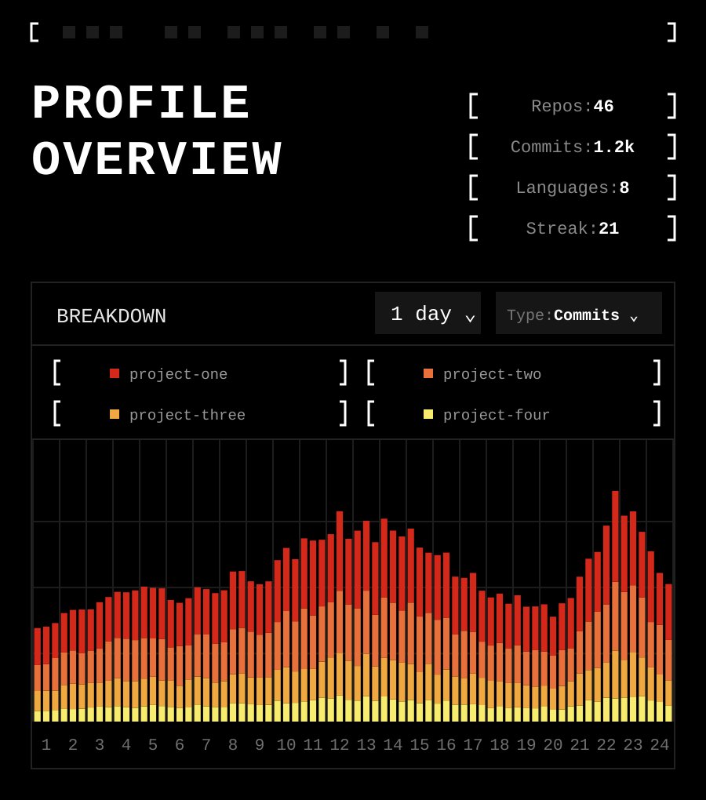

<div align="center">



</div>

<!-- Links -->
<p align="center">
  <a href="https://YOUR-SITE.example"></a>
  <a href="https://linkedin.com/in/YOUR-HANDLE"></a>
  <a href="mailto:YOUR-EMAIL@example.com"></a>
</p>

```text
[ ABOUT ]
Solomon Wilson — YOUR ROLE / FOCUS
Currently building: Project One, Project Two
Stack: Tech A · Tech B · Tech C
```
